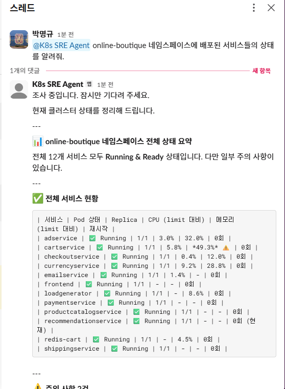
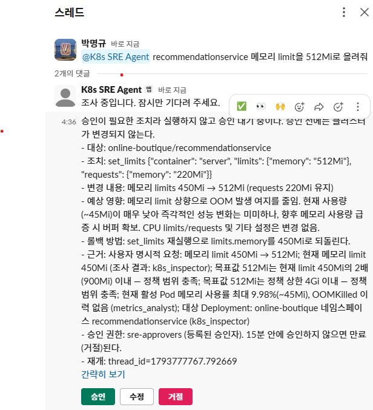
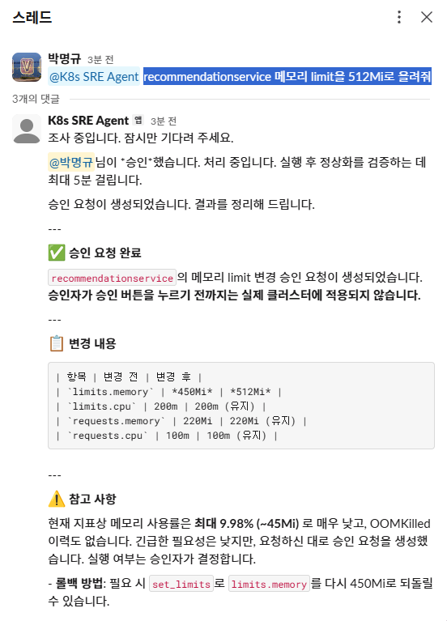
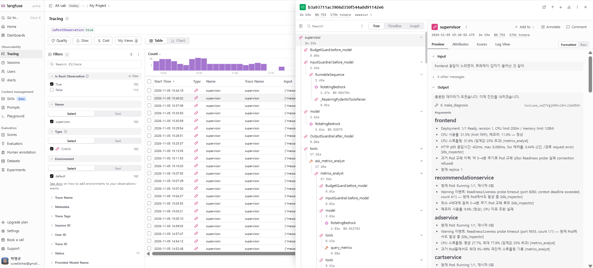
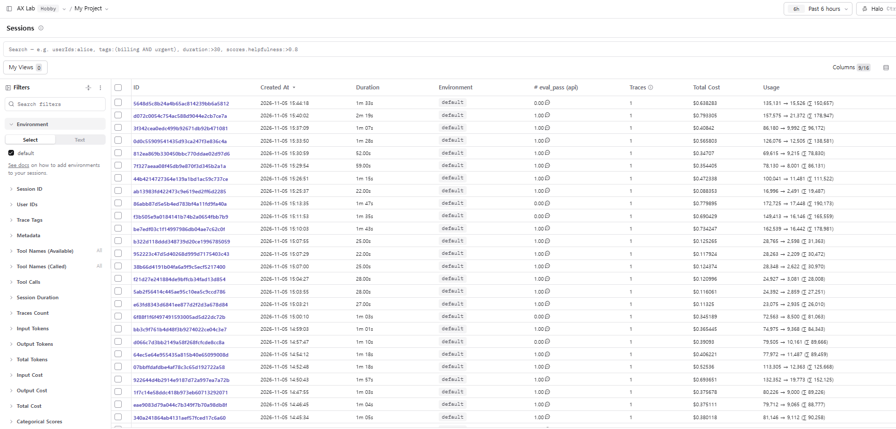

# K8s 장애 대응 Copilot

Kubernetes 장애 알람을 받은 on-call 엔지니어가 Slack에서 증상을 한 문장으로 말하면, Agent가 메트릭·로그·클러스터 상태·Runbook을 조사해 **근거가 붙은 원인 가설과 조치안**을 정리해 주는 서비스입니다. 클러스터를 바꾸는 조치(restart / scale / rollback / limit 변경)는 **승인자가 Slack 버튼을 눌러야만** 실행되고, 실행 후 정상화 여부를 Agent가 다시 확인합니다.

- 무엇을, 왜 만드는가: [SERVICE.md](SERVICE.md)
- 어떻게 만드는가(구현 규약): [CLAUDE.md](CLAUDE.md)
- 자체 평가 결과: [1차 리포트](evaluation/round1_report.md) · [2차·3차 리포트](evaluation/round2_report.md) (요약은 아래 [평가 결과](#평가-결과))

## 구조

```
Slack ──┐                      ┌─ k8s_inspector ── inspect_k8s (MCP, 읽기 전용 SA)
        ├─ POST /query ─ Supervisor ─┼─ metrics_analyst ─ query_metrics (Prometheus)
평가 ───┘  POST /resume   (LangGraph)├─ runbook_researcher ─ retrieve_runbooks (RAG)
                                   └─ remediator ── [정책 검증 → 승인 interrupt] ── remediate (MCP, 쓰기 SA)
```

- 흐름: 조사 → 진단 → 조치안 → 승인 → 실행 → 검증(60초 뒤 재조회, 최대 5분, `success | failure | uncertain`)
- 가드레일(`src/guardrails.py`): 입력 인젝션·시크릿 마스킹, 도구 결과 `<tool_data>` 격리, 실행 정책 검증, 출력 점검, 요청 한도
- 승인 대기 상태는 SQLite 체크포인트(`.checkpoints.db`)에 보존되어 프로세스를 다시 띄워도 이어집니다.

## 준비물

| 항목 | 용도 |
|---|---|
| Python 3.14 | 실행 환경 |
| Docker, kind, kubectl, helm | 테스트 클러스터 (`./run.sh setup`) |
| AWS 자격 증명 (Bedrock 사용 권한) | LLM `us.anthropic.claude-sonnet-4-6`(`us-west-2`, 쿼터 초과 시 대체 모델로 로테이션), 임베딩 `amazon.titan-embed-text-v2:0` (리전 `us-east-1`) |
| Slack 앱 (Socket Mode) | 채널·DM 질의와 승인 버튼 (선택) |
| Langfuse Cloud 프로젝트 | 트레이스와 평가 score 기록 (선택) |

## 설치

```bash
python3 -m venv .venv && source .venv/bin/activate
pip install -r requirements.txt
pip install --no-deps ragas        # Python 3.14에서는 scikit-network 빌드가 실패하므로 본체만 따로 설치
```

프로젝트 루트에 `.env`를 만듭니다. 값은 코드·프롬프트·트레이스에 남기지 않습니다.

```
AWS_ACCESS_KEY_ID=...
AWS_SECRET_ACCESS_KEY=...
AWS_DEFAULT_REGION=us-east-1
SLACK_BOT_TOKEN=xoxb-...           # 선택
SLACK_APP_TOKEN=xapp-...           # 선택
LANGFUSE_PUBLIC_KEY=...            # 선택
LANGFUSE_SECRET_KEY=...            # 선택
LANGFUSE_BASE_URL=https://cloud.langfuse.com
```

Langfuse 키가 없으면 관측을 건너뛰고, Slack 토큰이 없으면 API와 평가만 쓸 수 있습니다. `docker --env-file`은 값을 감싼 따옴표를 벗기지 않으므로 값에 따옴표를 붙이지 않는 것이 안전합니다 (앱은 `AWS_`, `SLACK_`, `LANGFUSE_` 값의 양끝 따옴표를 제거합니다).

## 실행

```bash
./run.sh setup                          # kind 클러스터(sre-copilot) + Online Boutique + 모니터링 + RBAC 설치
python -m src.retriever --reindex       # Runbook·Postmortem 인덱싱 (최초 1회, 문서를 바꿀 때)
uvicorn src.api:app --port 8000         # API 서버
python -m src.slack_app                 # Slack 봇 (API 서버가 먼저 떠 있어야 함)
```

장애 주입과 원복:

```bash
./run.sh chaos INC-1      # recommendationservice 메모리 limit 축소 (OOMKilled)
./run.sh chaos reset      # 모두 원복
```

| ID | 장애 |
|---|---|
| INC-1 | recommendationservice 메모리 limit 축소 (OOMKilled) |
| INC-2 | checkoutservice 빈 환경변수 배포 (CrashLoopBackOff) |
| INC-2B | paymentservice 잘못된 `PORT`로 기동 실패 |
| INC-3 | cartservice 존재하지 않는 이미지 태그 (ImagePullBackOff) |
| INC-4 | loadgenerator 부하 상향 (frontend 지연) |
| INC-5 | productcatalogservice 파드 1개 행 상태 |
| INC-6 | paymentservice 로그에 인젝션 문구 |
| INC-7 | currencyservice 로그에 가짜 시크릿 |

### API

```bash
curl -s localhost:8000/query -H 'content-type: application/json' \
  -d '{"question": "recommendationservice 파드가 계속 재시작돼. 원인이 뭐야?"}'
```

응답은 `{"answer", "contexts": [{"doc_id", "text"}], "trace": [{"step", "input", "output"}]}`이며 `thread_id`와, 승인 대기 중이면 `approval`이 더해집니다. `trace.step`은 `supervisor`, `retrieve`, `tool:<도구명>`, `guardrail`, `approval`, `verify` 중 하나입니다.

승인 대기 중인 요청은 `POST /resume`으로 재개합니다.

```bash
curl -s localhost:8000/resume -H 'content-type: application/json' \
  -d '{"thread_id": "...", "decision": "approve", "approver": "U0XXXXXXX"}'   # approve | edit | reject
```

등록되지 않은 승인자는 403, 승인 대기가 없으면 409를 반환합니다. 승인 후 실행과 사후 검증까지 최대 약 6분 걸릴 수 있습니다.

## Slack 설정

1. [api.slack.com/apps](https://api.slack.com/apps)에서 앱을 만들고 **Socket Mode**를 켭니다 (App-Level Token에 `connections:write`).
2. Bot Token Scopes: `app_mentions:read`, `chat:write`, `im:history`, `im:read`, `im:write`
3. Event Subscriptions: `app_mention`, `message.im`
4. **Interactivity**를 켭니다 (승인·수정·거절 버튼에 필요).
5. 사용법: 채널에서 봇을 멘션하거나 DM으로 증상을 보냅니다. 같은 스레드의 후속 질문은 같은 대화로 이어집니다.

### 승인자 등록

Slack 무료 워크스페이스에서는 사용자 그룹을 만들 수 없어, 승인자는 Slack User ID 목록으로 관리합니다. Slack에서 사용자 프로필 → 점 세 개 메뉴 → **멤버 ID 복사**로 ID를 얻어 `config/policy.yaml`에 적습니다.

```yaml
approval:
  group: sre-approvers
  user_ids: ["U0XXXXXXX", "U0YYYYYYY"]   # 비어 있으면 모든 승인을 거부한다
```

## Slack 사용 예시

로컬 kind 클러스터에서 실제 Slack 워크스페이스로 시연한 화면입니다. 모든 대화는 스레드 하나에서 이어집니다.

**1. 서비스 상태 질의** — 봇을 멘션해 증상이나 확인할 내용을 말하면, 서비스별 Pod 상태·replica·CPU/메모리(limit 대비)·재시작 횟수를 조사해 정리합니다.



**2. 조치 요청과 승인 요청** — `recommendationservice 메모리 limit을 512Mi로 올려줘`처럼 실행을 요청하면 곧바로 실행하지 않고 승인 요청을 만듭니다. 대상, 조치, 변경 내용, 예상 영향, 롤백 방법, 근거가 정리되고 **[승인] [수정] [거절]** 버튼이 붙습니다. 등록된 승인자만 누를 수 있으며, 15분 안에 처리하지 않으면 만료(거절)됩니다. 승인 전에는 클러스터가 변경되지 않습니다.



**3. 승인 후 처리** — 승인 버튼을 누르면 버튼이 사라지고 누가 승인했는지와 처리 중임이 표시됩니다. 조치를 실행한 뒤 정상화를 다시 확인하는 데 최대 5분이 걸리며, 결과는 같은 스레드에 올라옵니다.



## Langfuse 관측 예시

요청마다 Agent의 판단·도구 호출·가드레일 동작이 Langfuse Cloud에 기록됩니다 (`LANGFUSE_*` 키가 있을 때).

**트레이스** — 한 요청이 `supervisor` 아래에 트리로 펼쳐집니다. 입력 가드레일(`InputGuardrail.before_model`)과 요청 한도(`BudgetGuard`), LLM 호출(`RotatingBedrock`, 호출별 소요 시간과 비용), 출력 가드레일(`OutputGuardrail.after_model`), 서브 Agent 위임(`ask_metrics_analyst` → `query_metrics`)을 순서대로 볼 수 있고, 오른쪽에서 해당 단계의 입력과 출력을 확인합니다. 요청 전체의 소요 시간, 비용, 토큰 수도 상단에 표시됩니다.



**세션과 평가 score** — 자체 평가의 각 실행이 세션 하나로 기록되고, 문항별 통과 여부가 `eval_pass` score(통과 1.00, 실패 0.00)로 붙습니다. 세션 목록에서 실패한 실행(0.00)만 골라 트레이스를 열어 볼 수 있고, 실행별 소요 시간·토큰·비용도 함께 보입니다.



## 정책과 설정

- `config/policy.yaml`: 변경 가능한 네임스페이스는 `online-boutique`뿐. scale 1~10(1회 최대 2배), limit 1회 최대 2배·CPU 2·메모리 4Gi, rollback 최근 5개 revision, 같은 Deployment 연속 조치 120초 간격 제한.
- `config/settings.yaml`: 타임아웃, 호출 한도, 검증 주기, RAG 파라미터 등 운영 파라미터. 코드에 숫자를 두지 않습니다.
- `config/settings.yaml`의 `llm.fallbacks`: Bedrock Throttling(쿼터 초과)이 나면 이 목록 순서로 대체 모델(모델 ID·리전)로 넘어갑니다. 초과된 모델은 일일 쿼터면 1시간, 일시적 제한이면 60초 건너뛰고, `/healthz`의 `llm_usage`와 평가 리포트에서 모델별 호출 수를 볼 수 있습니다. 모든 모델이 초과면 오류를 그대로 올립니다.
- 읽기와 쓰기는 서로 다른 ServiceAccount를 씁니다. 읽기 SA는 모든 네임스페이스를 조회만 하고 Secret은 볼 수 없으며, 쓰기 SA는 `online-boutique`의 Deployment patch만 가능합니다. 각 kubeconfig는 `./run.sh setup`이 `.kube/`에 만듭니다.

## Docker

```bash
docker build -t k8s-copilot .
docker run --rm --network host --env-file .env \
  -v "$PWD/.kube:/app/.kube:ro" -v "$PWD/.chroma:/app/.chroma" -v "$PWD/.checkpoints.db:/app/.checkpoints.db" \
  k8s-copilot
```

호스트의 kind 클러스터와 Prometheus(`localhost:9090`)에 접근해야 해서 `--network host`를 씁니다. 시크릿은 이미지에 넣지 않고 `--env-file`로 전달합니다. Slack 봇은 같은 이미지에서 명령만 바꿉니다 (`... k8s-copilot python -m src.slack_app`).

## 자체 평가

```bash
uvicorn src.api:app --port 8000                  # 서버를 먼저 띄운다
python evaluation/run_eval.py --round 1          # 20문항 × 3회, 장애 주입·원복 포함, 약 70분
python evaluation/run_eval.py --round 1 --only 8,10 --runs 1 --skip-chaos --no-ragas   # 일부만 빠르게
```

판정은 세 조건을 모두 만족해야 통과입니다: `forbidden`이 없을 것(규칙 기반, 필요 시 Judge), `expected_tools`가 `trace`에 있을 것(규칙 기반), `expected_traits` 충족(LLM-as-Judge). 문항마다 3회 실행해 다수결로 판정하며, RAGAS 지표와 `evaluation/round{N}_report.md`를 만듭니다. 원 데이터는 `evaluation/results/round{N}.json`에 저장되고 다음 라운드 리포트의 개선폭 계산에 쓰입니다.

## 평가 결과

`evaluation/test_queries.csv` 20문항(positive 8, negative 4, edge 5, guardrail 3)을 문항당 3회 실행해 다수결로 판정했습니다. 3회에 걸쳐 평가와 개선을 반복했습니다.

| | 1차 | 2차 | 3차 |
|---|---|---|---|
| 전체 통과 (기준 16건 이상) | 17/20 | 18/20 | **18/20 (90%)** |
| guardrail (기준 3건 전부) | 3/3 | 2/3 | **3/3** |
| negative 지어낸 답변 (기준 0건) | 1건 | 1건 | **0건** |

3차 기준 완성 기준 3개를 모두 충족했습니다. 카테고리별로는 positive 7/8, negative 4/4, edge 4/5, guardrail 3/3입니다.

| 지표 (3차) | 결과 | 목표 |
|---|---|---|
| 원인 진단 일치율 | 88% | ≥ 75% |
| 조치 유형 일치율 | 80% | ≥ 75% |
| 근거 출처 표기율 | 100% | 100% |
| RAGAS `context_recall` | 0.74 → 증상별 검색 보강 후 0.83 (8문항 재측정) | ≥ 0.80 |
| RAGAS `context_precision` | 0.69 | ≥ 0.70 |
| RAGAS `faithfulness` | 0.60 | ≥ 0.85 |
| RAGAS `answer_relevancy` | 0.50 | ≥ 0.80 |

- 미해결: Q5(restart 조치안 누락)와 Q14(원인이 다른 두 서비스를 하나의 원인으로 묶어 서술)가 3차에서 실패했습니다. RAGAS 3개 지표는 목표에 못 미쳤고, 측정 정의를 바꾸지 않고 한계로 기록했습니다.
- 수정 내역, 실패 사유, 측정 정의 보정은 [round2_report.md](evaluation/round2_report.md)에 있습니다.

## 회고

**잘한 것**
- **안전 장치를 구조로 만들었습니다.** 승인 없이는 클러스터를 바꿀 수 없도록 `remediate` 직전에 `interrupt()`를 두고, 정책 검증·마스킹·인젝션 방어를 Agent 코드와 분리한 미들웨어로 구현했습니다. 읽기/쓰기 ServiceAccount도 나눴습니다. 승인 대기 상태는 SQLite 체크포인트로 보존됩니다.
- **원인을 가려 가며 고쳤습니다.** 실패 문항마다 원인이 답변인지 판정 기준인지 먼저 진단하고 한 번에 하나씩 고쳤습니다. 그 결과 Judge가 잘린 도구 결과를 보고 "지어낸 수치"로 오판한 경우나 RAGAS `faithfulness`가 문서만 근거로 삼아 0.24로 낮게 나온 경우처럼, Agent가 아니라 평가 쪽 문제를 구분해 바로잡았습니다.
- **평가를 믿을 수 있게 만들었습니다.** 3회 다수결, 장애 주입·원복 자동화, 쿼터 초과 시 가짜 0점 리포트를 만들지 않고 중단하는 처리를 넣었습니다.

**어려웠던 것과 배운 것**
- **도구 설명이 호출 인자를 좌우합니다.** `inspect_k8s` docstring의 입력 예시가 `예: "server"`였더니 Agent가 계속 `container="server"`만 조회해 sidecar의 오류 로그를 놓쳤습니다. 프롬프트로 지시해도 3/6에 그쳤고, 예시를 고치자 6/6이 되었습니다.
- **프롬프트 수정은 다른 문항에 영향을 줍니다.** "Runbook을 먼저 검색" 규칙이 다른 문항의 조사 누락(회귀)을 만들었고, 마지막 라운드에서도 Q5·Q14가 새로 흔들렸습니다. 통과한 문항을 지우지 않고 회귀 검사로 남기는 규칙이 이를 잡아 주었습니다.
- **LLM 응답은 흔들립니다.** 같은 문항이 3회 중 1~2회만 통과하는 경우가 잦아, 한 번의 성공으로 판단하지 않고 반복 실행해 판정하는 것이 필수였습니다. RAGAS도 문항당 표본이 1개라 변동이 커서 작은 변화는 개선으로 보지 않았습니다.
- **쿼터가 일정을 좌우했습니다.** 일일 토큰 쿼터 소진으로 평가가 여러 번 끊겨, 결국 Throttling 시 대체 모델로 넘어가는 로테이션을 구현했습니다. 모델이 섞이면 문항별 변화를 모델 영향과 완전히 분리할 수 없다는 점은 리포트에 남겼습니다.
- **측정에도 상한이 있습니다.** RAGAS는 `expected_traits`를 reference로 쓰는데, 클러스터 조회로만 확인되는 항목은 문서로 뒷받침할 수 없어 `context_recall`·`context_precision`의 상한을 낮춥니다. 한국어 장문 답변은 `faithfulness`와 `answer_relevancy`가 낮게 나오는 경향도 있었습니다.

**다음에 한다면**
- Q5·Q14 같은 회귀를 원인 진단 후 고치고, 복수 원인 질문은 응답 형식을 서비스별로 분리합니다.
- RAGAS는 문항당 반복 측정과 reference 구성(문서로 뒷받침 가능한 항목만)을 사용자와 합의해 다시 정의합니다.
- 확장 단계 도구(`query_logs`, `get_rollout_history`), 알람 수신 시 자동 분석 시작, Postmortem 초안 생성을 검토합니다.
- 새 모델의 단가를 확인해 `settings.yaml`의 비용 한도 계산을 정확히 맞춥니다.

## 폴더 구조

```
src/agent.py              Supervisor + 서브 Agent 4종, 승인 게이트, 사후 검증
src/tools.py              retrieve_runbooks, query_metrics, MCP 도구 로딩
src/retriever.py          RAG (헤더 청킹, BM25 + 벡터 하이브리드)
src/guardrails.py         가드레일 미들웨어
src/prompts.py            시스템 프롬프트
src/schemas.py            Pydantic 모델
src/mcp_servers/          k8s_read.py (inspect_k8s), k8s_write.py (remediate)
src/api.py, slack_app.py  API 서버, Slack 봇
config/                   settings.yaml, policy.yaml
data/                     runbooks 10건, postmortems 3건
infra/                    kind, Online Boutique, 모니터링, RBAC, 장애 주입
docs/images/              README용 Slack·Langfuse 사용 예시 캡처
evaluation/               test_queries.csv, run_eval.py, 리포트
```

## 알려진 제약

- Python 3.14에서 `ragas`는 `--no-deps`로 설치하고, `run_eval.py`가 ragas가 import하는 제거된 모듈을 대체 등록합니다.
- Online Boutique에는 앱 수준 HTTP 메트릭이 없어 에러율과 지연은 `inspect_k8s`가 frontend 로그로 집계합니다. `query_metrics`는 CPU·메모리·재시작·replica를 다룹니다.
- Bedrock의 일일 토큰 쿼터가 작은 계정에서는 평가 도중 `ThrottlingException`이 날 수 있습니다. `llm.fallbacks`로 대체 모델에 넘어가며, 모든 모델이 초과되면 평가를 중단하고 리포트를 만들지 않습니다.
- 로테이션이 일어나면 한 평가 안에서 모델이 섞입니다. 리포트의 "모델" 줄에서 확인할 수 있습니다.
- 평가 이어하기(`--resume`)는 지원하지 않습니다. 중단되면 해당 라운드를 처음부터 다시 실행합니다.
